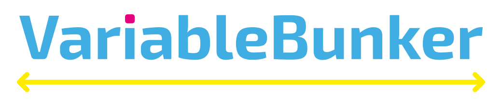
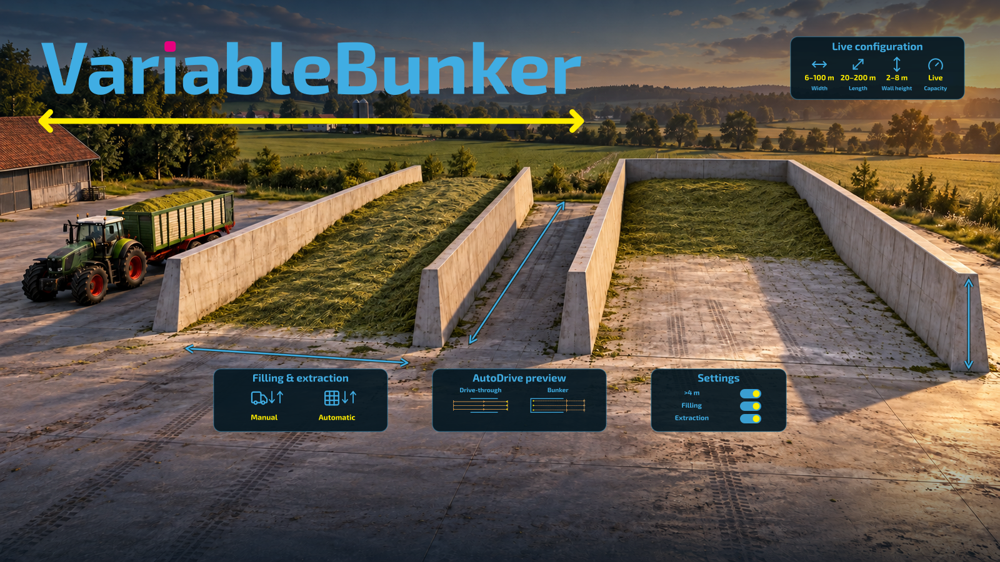
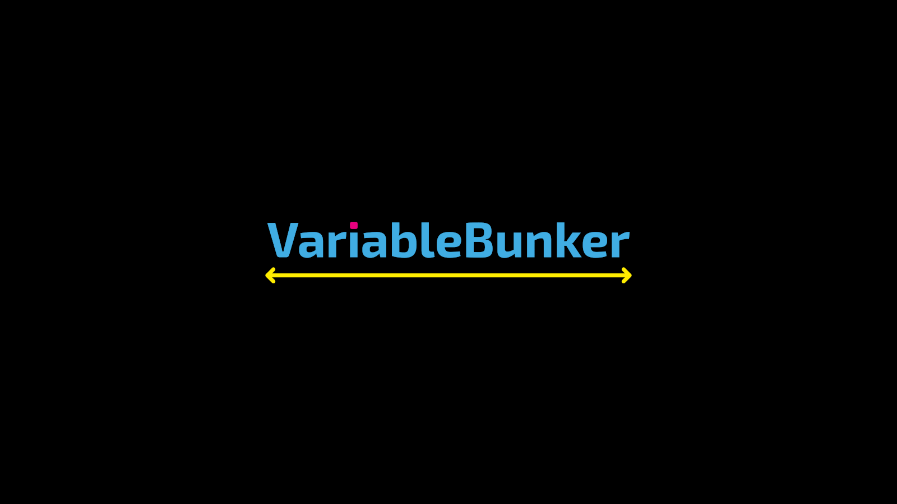
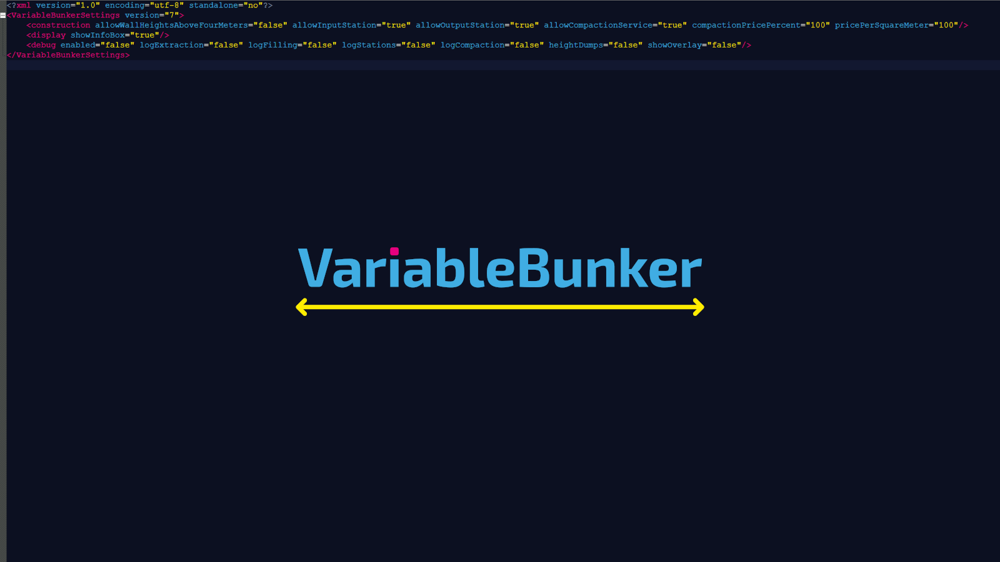
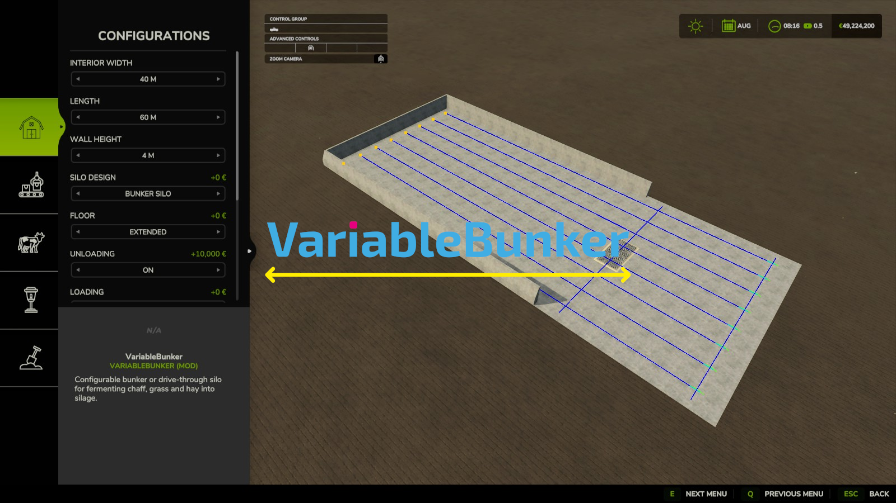
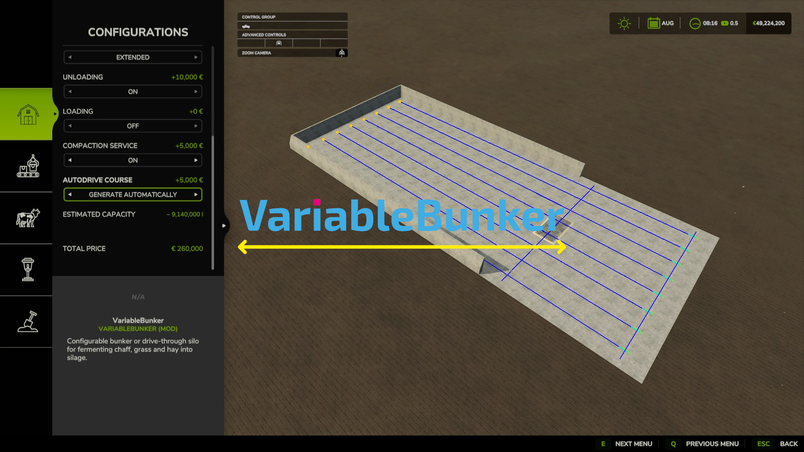
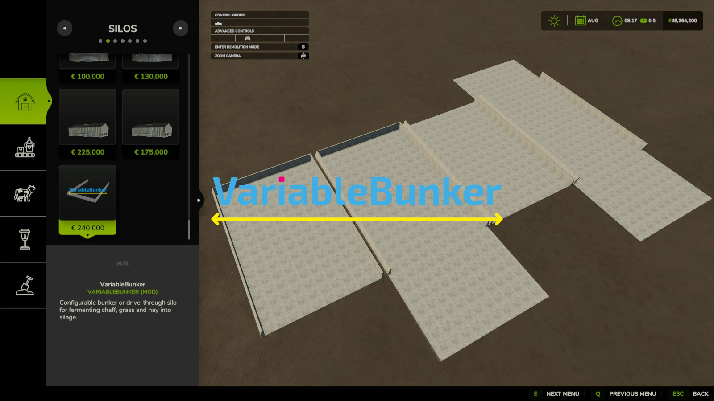
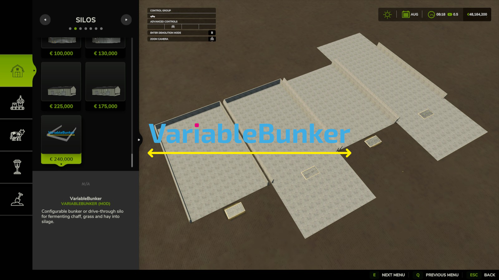
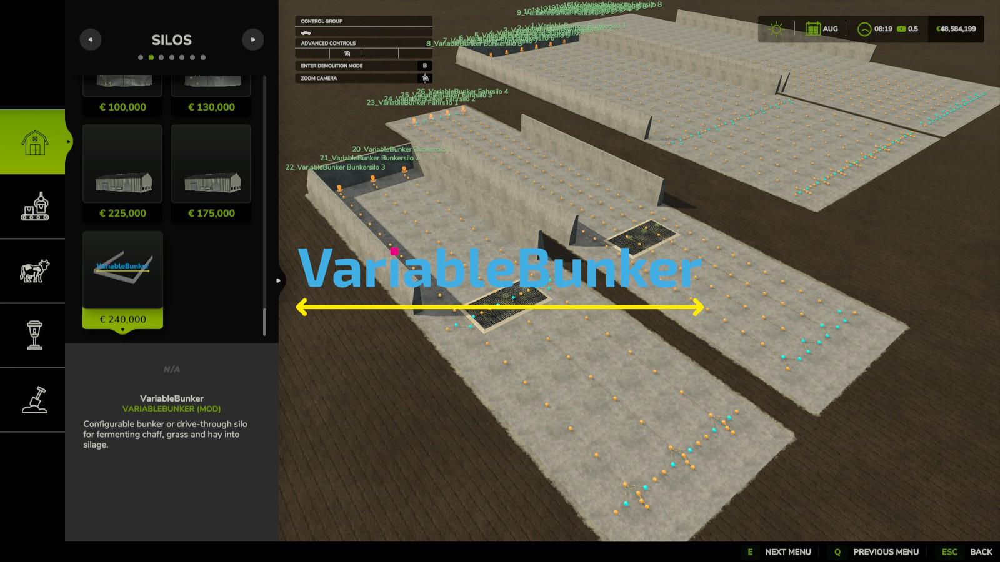

<div align="center"></div>

# <div align="center"></div>

<div align="center">

[](https://github.com/BLU3COW/FS25_VariableBunker/releases/latest)
[](https://github.com/BLU3COW/FS25_VariableBunker)
[](https://github.com/BLU3COW/FS25_VariableBunker)
[](https://github.com/BLU3COW/FS25_VariableBunker/releases)
[](https://github.com/BLU3COW/FS25_VariableBunker/issues)
[](https://github.com/BLU3COW/FS25_VariableBunker/discussions)
[](https://github.com/BLU3COW/FS25_VariableBunker/pulls)
[](https://discord.gg/JdKvhdheU)
[](LICENSE)
[](mailto:mail@blu3cow.com)
</div>


<div align="center">

[WEBSITE](https://blu3cow.com) | [DISCORD](https://discord.gg/JdKvhdheU) | [DOWNLOAD](https://github.com/BLU3COW/FS25_VariableBunker/releases) | [README](README.md) |  [LICENSE](LICENSE) | [ISSUES](https://github.com/BLU3COW/FS25_VariableBunker/issues) | [DISCUSSIONS](https://github.com/BLU3COW/FS25_VariableBunker/discussions) | [PULLS](https://github.com/BLU3COW/FS25_VariableBunker/pulls)
</div>


<div align="center">

[](https://www.paypal.com/donate/?hosted_button_id=JAB2D3DPW2794)
[](https://buymeacoffee.com/blu3cow)
</div>
<br>


<div align="center">With <strong>VariableBunker</strong>, you get a single silo that adapts to your farm instead of the other way around. Choose between a <strong>bunker silo</strong> with rear wall and a <strong>drive-through silo</strong> open at both ends, and set the interior width, length, and wall height freely in construction mode. Walls, collisions, the silo area, and all placement areas follow the selected dimensions, and the purchase price grows with the size.
<br><br>
An optional concrete floor slab, an unloading grid, a loading point, a compaction service, and an automatically generated <strong>AutoDrive</strong> course complete the silo. Further improvements are already being considered. Want to help shape the project? Feel free to get involved and share your requests, suggestions, or ideas for improvement.</div>
<br>
<div align="center">

<details>
<summary><div align="center"> ➡️​ <strong>Deutsch</strong> ⬅️ ​</div></summary>
<br>
<div align="center">Mit <strong>VariableBunker</strong> bekommst du ein einziges Silo, das sich deinem Hof anpasst und nicht umgekehrt. Wähle zwischen einem <strong>Bunkersilo</strong> mit Rückwand und einem <strong>Fahrsilo</strong>, das an beiden Enden offen ist, und stelle Innenbreite, Länge und Wandhöhe im Baumodus frei ein. Wände, Kollisionen, Silobereich und alle Platzierungsflächen folgen den gewählten Abmessungen, und der Kaufpreis wächst mit der Größe.
<br><br>
Eine optionale Beton-Bodenplatte, eine Abladestelle mit Bodengitter, eine Ladestelle, ein Verdichtungsservice und ein automatisch erzeugter <strong>AutoDrive</strong>-Kurs runden das Silo ab. Weitere Verbesserungen sind bereits in Überlegung. Du möchtest das Projekt mitgestalten? Dann bring dich gerne ein und teile deine Wünsche, Vorschläge oder Ideen zur Verbesserung.</div>
</details>
</div>
<br>


<div align="center">





</div>
<br>


## <div align="center"></div>
<div align="center">

| Design | Rear wall | Open ends | AutoDrive course | Default |
| --- | --- | --- | --- | --- |
| Bunker silo | ✔️ | Front | Two-way lanes with turnaround | ON |
| Drive-through silo | --- | Front and rear | One-way lanes | OFF |
</div>
<br>

<div align="center">Choose the design when configuring VariableBunker in construction mode, before placing it. The <strong>bunker silo</strong> is closed on three sides by concrete side walls and a full-width rear wall. The <strong>drive-through silo</strong> keeps only the side walls, so it can be filled and emptied from both ends. Both designs accept chaff, grass, and hay and ferment them into silage.</div>
<br>
<div align="center">

<details>
<summary><div align="center"> ➡️​ <strong>Deutsch</strong> ⬅️ ​</div></summary>
<br>
<div align="center">Die Bauart wählst du bei der Konfiguration von VariableBunker im Baumodus, bevor du es platzierst. Das <strong>Bunkersilo</strong> ist an drei Seiten durch Beton-Seitenwände und eine Rückwand über die volle Breite geschlossen. Das <strong>Fahrsilo</strong> behält nur die Seitenwände und kann deshalb von beiden Enden befüllt und geleert werden. Beide Bauarten nehmen Häckselgut, Gras und Heu an und vergären es zu Silage.</div>
</details>
</div>
<br>


## <div align="center"></div>

<div align="center">

| Dimension | Minimum | Maximum | Steps | Default |
| --- | --- | --- | --- | --- |
| Interior width | 6 m | 100 m | 1 m up to 20 m, then 5 m | 40 m |
| Length | 20 m | 200 m | 5 m up to 50 m, then 10 m | 60 m |
| Wall height | 2 m | 4 m (8 m when enabled) | 1 m | 4 m |

</div>
<br>

<div align="center">All dimensions are set in construction mode before the silo is placed. The configuration list shows the estimated capacity and the total price and updates both with every change. The wall insides stay vertical; on the outside, each wall rises vertically for 1.5 m and then slopes inward, so taller walls automatically get a wider base.<br><br><strong>Price:</strong> 100 € per square meter of interior floor with 4 m walls. Each meter of wall height above or below 4 m changes the price by 12.5 % (2 m: 75 %, 8 m: 150 %), so a 40 × 60 m silo with 4 m walls costs 240,000 €. The price per square meter can be changed in the settings. As with the base game silos, the daily upkeep is one thousandth of the price, 240 € per day for the default silo.<br><br><strong>Fill height and map limit:</strong> bulk material piles up to the wall height at most, and never higher than the map allows. Most maps, including all base game maps, limit piles to <strong>4 m</strong> above the ground, so a 5 to 8 m wall would cost more but hold exactly as much as a 4 m wall. Wall heights above 4 m are therefore <strong>switched off by default</strong>. On a map with a higher limit, enable them with <strong>allowWallHeightsAboveFourMeters</strong> in the settings; if the map still caps the selected height, the capacity line in the configuration list names the limit.</div>
<br>
<div align="center">

<details>
<summary><div align="center"> ➡️​ <strong>Deutsch</strong> ⬅️ ​</div></summary>
  <br>
<div align="center">Alle Abmessungen werden im Baumodus vor dem Platzieren eingestellt. Die Konfigurationsliste zeigt das geschätzte Fassungsvermögen und den Gesamtpreis und aktualisiert beides bei jeder Änderung. Die Wandinnenseiten bleiben senkrecht; außen steigt jede Wand 1,5 m senkrecht an und verläuft danach schräg nach innen, sodass höhere Wände automatisch einen breiteren Fuß bekommen.<br><br><strong>Preis:</strong> 100 € je Quadratmeter Innenfläche bei 4 m Wandhöhe. Jeder Meter Wandhöhe mehr oder weniger als 4 m ändert den Preis um 12,5 % (2 m: 75 %, 8 m: 150 %), ein Silo mit 40 × 60 m und 4 m Wänden kostet also 240.000 €. Der Preis je Quadratmeter lässt sich in den Einstellungen ändern. Wie bei den Silos aus dem Basisspiel beträgt der tägliche Unterhalt ein Tausendstel des Preises, beim Standardsilo 240 € pro Tag.<br><br><strong>Füllhöhe und Kartengrenze:</strong> Schüttgut liegt höchstens bis zur Wandhöhe und nie höher, als die Karte erlaubt. Die meisten Karten, darunter alle Basisspiel-Karten, begrenzen Schüttungen auf <strong>4 m</strong> über dem Boden; eine 5 bis 8 m hohe Wand würde dort mehr kosten, aber genau so viel fassen wie eine 4-m-Wand. Wandhöhen über 4 m sind deshalb <strong>standardmäßig ausgeschaltet</strong>. Auf einer Karte mit höherer Grenze lassen sie sich mit <strong>allowWallHeightsAboveFourMeters</strong> in den Einstellungen freischalten; begrenzt die Karte die gewählte Höhe trotzdem, nennt die Kapazitätszeile in der Konfigurationsliste die Grenze.</div>
</details>
</div>
<br>


## <div align="center"></div>

<div align="center">

**Bunker silo** (liters per wall height)

| Interior width × length | 2 m | 3 m | 4 m | 5 m | 6 m | 7 m | 8 m |
| --- | --- | --- | --- | --- | --- | --- | --- |
| 6 × 20 m | 220,000 | 320,000 | 410,000 | 500,000 | 570,000 | 640,000 | 710,000 |
| 10 × 40 m | 770,000 | 1,100,000 | 1,500,000 | 1,800,000 | 2,200,000 | 2,500,000 | 2,800,000 |
| 15 × 50 m | 1,400,000 | 2,100,000 | 2,800,000 | 3,500,000 | 4,100,000 | 4,800,000 | 5,400,000 |
| 20 × 60 m | 2,300,000 | 3,500,000 | 4,600,000 | 5,700,000 | 6,700,000 | 7,700,000 | 8,800,000 |
| 30 × 100 m | 5,900,000 | 8,800,000 | 12,000,000 | 14,000,000 | 17,000,000 | 20,000,000 | 23,000,000 |
| 40 × 60 m | 4,700,000 | 6,900,000 | 9,100,000 | 11,000,000 | 13,000,000 | 15,000,000 | 18,000,000 |
| 50 × 150 m | 15,000,000 | 22,000,000 | 29,000,000 | 37,000,000 | 44,000,000 | 51,000,000 | 58,000,000 |
| 100 × 200 m | 40,000,000 | 59,000,000 | 79,000,000 | 98,000,000 | 118,000,000 | 137,000,000 | 156,000,000 |

**Drive-through silo** (liters per wall height)

| Interior width × length | 2 m | 3 m | 4 m | 5 m | 6 m | 7 m | 8 m |
| --- | --- | --- | --- | --- | --- | --- | --- |
| 6 × 20 m | 200,000 | 280,000 | 340,000 | 390,000 | 430,000 | 450,000 | 450,000 |
| 10 × 40 m | 730,000 | 1,100,000 | 1,400,000 | 1,700,000 | 1,900,000 | 2,100,000 | 2,400,000 |
| 15 × 50 m | 1,400,000 | 2,000,000 | 2,700,000 | 3,200,000 | 3,800,000 | 4,300,000 | 4,700,000 |
| 20 × 60 m | 2,300,000 | 3,300,000 | 4,300,000 | 5,300,000 | 6,200,000 | 7,100,000 | 7,900,000 |
| 30 × 100 m | 5,800,000 | 8,600,000 | 11,000,000 | 14,000,000 | 17,000,000 | 19,000,000 | 21,000,000 |
| 40 × 60 m | 4,500,000 | 6,600,000 | 8,700,000 | 11,000,000 | 12,000,000 | 14,000,000 | 16,000,000 |
| 50 × 150 m | 15,000,000 | 22,000,000 | 29,000,000 | 36,000,000 | 43,000,000 | 49,000,000 | 56,000,000 |
| 100 × 200 m | 39,000,000 | 59,000,000 | 78,000,000 | 97,000,000 | 115,000,000 | 133,000,000 | 152,000,000 |

</div>
<br>

<div align="center">The values are approximate and assume a completely filled silo with a flat top at the wall height and a natural slope of 40° at each open end: one slope for the bunker silo, two for the drive-through silo. One cubic meter holds 1,000 liters. Grass and hay are converted to chaff liter for liter when tipped into the silo, so the tables apply to all accepted fill types.<br><br><strong>Map limit:</strong> the columns above 4 m only apply on maps that allow higher piles and after enabling wall heights above 4 m in the settings. On base game maps and most other maps, the 4 m column is the maximum.</div>
<br>
<div align="center">

<details>
<summary><div align="center"> ➡️​ <strong>Deutsch</strong> ⬅️ ​</div></summary>
  <br>

**Bunkersilo** (Liter je Wandhöhe)

| Innenbreite × Länge | 2 m | 3 m | 4 m | 5 m | 6 m | 7 m | 8 m |
| --- | --- | --- | --- | --- | --- | --- | --- |
| 6 × 20 m | 220.000 | 320.000 | 410.000 | 500.000 | 570.000 | 640.000 | 710.000 |
| 10 × 40 m | 770.000 | 1.100.000 | 1.500.000 | 1.800.000 | 2.200.000 | 2.500.000 | 2.800.000 |
| 15 × 50 m | 1.400.000 | 2.100.000 | 2.800.000 | 3.500.000 | 4.100.000 | 4.800.000 | 5.400.000 |
| 20 × 60 m | 2.300.000 | 3.500.000 | 4.600.000 | 5.700.000 | 6.700.000 | 7.700.000 | 8.800.000 |
| 30 × 100 m | 5.900.000 | 8.800.000 | 12.000.000 | 14.000.000 | 17.000.000 | 20.000.000 | 23.000.000 |
| 40 × 60 m | 4.700.000 | 6.900.000 | 9.100.000 | 11.000.000 | 13.000.000 | 15.000.000 | 18.000.000 |
| 50 × 150 m | 15.000.000 | 22.000.000 | 29.000.000 | 37.000.000 | 44.000.000 | 51.000.000 | 58.000.000 |
| 100 × 200 m | 40.000.000 | 59.000.000 | 79.000.000 | 98.000.000 | 118.000.000 | 137.000.000 | 156.000.000 |

**Fahrsilo** (Liter je Wandhöhe)

| Innenbreite × Länge | 2 m | 3 m | 4 m | 5 m | 6 m | 7 m | 8 m |
| --- | --- | --- | --- | --- | --- | --- | --- |
| 6 × 20 m | 200.000 | 280.000 | 340.000 | 390.000 | 430.000 | 450.000 | 450.000 |
| 10 × 40 m | 730.000 | 1.100.000 | 1.400.000 | 1.700.000 | 1.900.000 | 2.100.000 | 2.400.000 |
| 15 × 50 m | 1.400.000 | 2.000.000 | 2.700.000 | 3.200.000 | 3.800.000 | 4.300.000 | 4.700.000 |
| 20 × 60 m | 2.300.000 | 3.300.000 | 4.300.000 | 5.300.000 | 6.200.000 | 7.100.000 | 7.900.000 |
| 30 × 100 m | 5.800.000 | 8.600.000 | 11.000.000 | 14.000.000 | 17.000.000 | 19.000.000 | 21.000.000 |
| 40 × 60 m | 4.500.000 | 6.600.000 | 8.700.000 | 11.000.000 | 12.000.000 | 14.000.000 | 16.000.000 |
| 50 × 150 m | 15.000.000 | 22.000.000 | 29.000.000 | 36.000.000 | 43.000.000 | 49.000.000 | 56.000.000 |
| 100 × 200 m | 39.000.000 | 59.000.000 | 78.000.000 | 97.000.000 | 115.000.000 | 133.000.000 | 152.000.000 |

<div align="center">Die Werte sind Näherungen für ein vollständig gefülltes Silo mit ebener Oberfläche auf Wandhöhe und einer natürlichen Böschung von 40° an jedem offenen Ende: eine beim Bunkersilo, zwei beim Fahrsilo. Ein Kubikmeter fasst 1.000 Liter. Gras und Heu werden beim Abkippen ins Silo Liter für Liter in Häckselgut umgewandelt, daher gelten die Tabellen für alle angenommenen Fruchtsorten.<br><br><strong>Kartengrenze:</strong> Die Spalten über 4 m gelten nur auf Karten, die höhere Schüttungen erlauben, und erst nachdem Wandhöhen über 4 m in den Einstellungen freigeschaltet wurden. Auf Basisspiel-Karten und den meisten anderen Karten ist die 4-m-Spalte das Maximum.</div>
</details>
</div>
<br>


## <div align="center"></div>

<div align="center">

| Option | Choices | Default | Price |
| --- | --- | --- | --- |
| Floor (concrete slab) | None / Standard / Extended | None | free |
| Unloading (floor grid) | Off / On | Off | 10,000 € |
| Loading (loading point) | Off / On | Off | 10,000 € |
| Compaction service | Off / On | Off | 5,000 € |
| AutoDrive course | Off / Generate automatically | Off | 5,000 € |

</div>
<br>

<div align="center">The <strong>floor</strong> is a concrete slab across the complete outside width, wall bases included. <strong>Standard</strong> ends flush with the silo, <strong>Extended</strong> adds an apron: 30 m in front of a bunker silo, or 30 m in front of the entrance and 20 m behind the exit of a drive-through silo.
<br><br>
<strong>Unloading</strong> places a floor grid 4 m in front of the entrance. While the silo is open, it takes chaff, grass, and hay from trailers and bales; grass and hay become chaff liter for liter. The bunker silo fills as a wedge from the rear wall towards the entrance, the drive-through silo in even layers across its whole length.
<br><br>
<strong>Loading</strong> uses the same spot without a grid of its own and hands out only silage, after fermentation. It cuts the silage from the entrance towards the back as a clean 40° face from wall to wall and opens the cover just ahead of the face. The loading rate can be adjusted with AdjustSuite ADR-P.
<br><br>
The <strong>compaction service</strong> is ordered on foot at the grid with the activate key and compacts the remaining material to 100 % at once. It is billed like a contractor working 300,000 l per hour: helper wage plus 40 € wear per hour, both scaled by the economic difficulty, plus 20 l of diesel per hour.
<br><br>
The <strong>AutoDrive course</strong> option only appears when AutoDrive is active in the savegame (see below); the stations themselves do not create AutoDrive routes or targets. While you are at the silo, an <strong>info box</strong> shows the fill level, compaction, fermentation with the remaining time, and the next step.</div>
<br>
<div align="center">

<details>
<summary><div align="center"> ➡️​ <strong>Deutsch</strong> ⬅️ ​</div></summary>
  <br>
<div align="center">Die <strong>Bodenplatte</strong> ist eine Betonplatte über die gesamte Außenbreite einschließlich der Wandfüße. <strong>Standard</strong> endet bündig mit dem Silo, <strong>Erweitert</strong> ergänzt einen Vorplatz: 30 m vor einem Bunkersilo, bzw. 30 m vor der Einfahrt und 20 m hinter der Ausfahrt eines Fahrsilos.
<br><br>
Die <strong>Abladestelle</strong> setzt ein Bodengitter 4 m vor die Einfahrt. Solange das Silo offen ist, nimmt es Häckselgut, Gras und Heu von Anhängern und aus Ballen an; Gras und Heu werden Liter für Liter zu Häckselgut. Das Bunkersilo füllt sich als Keil von der Rückwand zur Einfahrt, das Fahrsilo in gleichmäßigen Schichten über die ganze Länge.
<br><br>
Die <strong>Ladestelle</strong> liegt an derselben Stelle, ohne eigenes Gitter, und gibt nach der Gärung ausschließlich Silage aus. Sie trägt die Silage von der Einfahrt nach hinten als saubere 40°-Anschnittfläche von Wand zu Wand ab und öffnet die Abdeckung kurz vor der Anschnittkante. Die Laderate lässt sich mit AdjustSuite ADR-P einstellen.
<br><br>
Den <strong>Verdichtungsservice</strong> bestellst du zu Fuß am Gitter per Aktivieren-Taste; er verdichtet das restliche Material sofort auf 100 %. Abgerechnet wird wie bei einem Lohnunternehmer mit 300.000 l pro Stunde: Helferlohn plus 40 € Verschleiß pro Stunde, beides skaliert mit dem Wirtschaftsschwierigkeitsgrad, dazu 20 l Diesel pro Stunde.
<br><br>
Die Option <strong>AutoDrive-Kurs</strong> erscheint nur, wenn AutoDrive im Spielstand aktiv ist (siehe unten); die Stationen selbst erzeugen keine AutoDrive-Kurse oder Ziele. Am Silo zeigt eine <strong>Infobox</strong> Füllstand, Verdichtung, Gärung mit Restzeit und den nächsten Schritt.</div>
</details>
</div>
<br>


## <div align="center"></div>

<div align="center">

| Design | Lanes | Lane layout | Destinations |
| --- | --- | --- | --- |
| Bunker silo | One per 5 m of width (20 at 100 m) | Two-way, cross connections 4 m and 26 m in front of the silo, turnaround 27 m in front | 2 m before the rear wall |
| Drive-through silo | One per 3.5 m of width | One-way from 25 m before the entrance to 15 m beyond the exit | At the end of each lane |

</div>
<br>

<div align="center">When the option is enabled, a visual course preview appears while the silo is being configured and positioned. The actual course is created only once after placement and adapts to the selected width and length. The layouts follow the AutoDrive reference courses for the BGA bunker silo and the large bunker silo. Cancelling placement creates no waypoints, loading a savegame never creates duplicate nodes, and selling the silo removes its waypoints again. Without AutoDrive, the silo works completely on its own.</div>
<br>
<div align="center">

<details>
<summary><div align="center"> ➡️​ <strong>Deutsch</strong> ⬅️ ​</div></summary>
  <br>
<div align="center">Ist die Option aktiviert, erscheint während der Konfiguration und Positionierung eine visuelle Kursvorschau. Der eigentliche Kurs wird erst nach dem Platzieren einmalig erzeugt und passt sich an die gewählte Breite und Länge an. Die Aufteilung folgt den AutoDrive-Referenzkursen für das BGA-Bunkersilo und das große Fahrsilo des Basisspiels. Ein Abbruch erzeugt keine Wegpunkte, beim Laden eines Spielstands entstehen nie doppelte Knoten, und beim Verkauf des Silos werden seine Wegpunkte wieder entfernt. Ohne AutoDrive funktioniert das Silo vollständig eigenständig.</div>
</details>
</div>
<br>


## <div align="center"></div>

<div align="center">

| Setting | English | German | Default |
| --- | --- | --- | --- |
| **allowWallHeightsAboveFourMeters** | Wall heights above 4 m (only for maps with a higher fill limit) | Wandhöhen über 4 m (nur für Karten mit höherer Füllgrenze) | false |
| **allowInputStation** | Filling through the floor grid | Befüllen über das Bodengitter | true |
| **allowOutputStation** | Loading point | Ladestelle | true |
| **allowCompactionService** | Compaction service | Verdichtungsservice | true |
| **compactionPricePercent** | Compaction price (0 to 1000 %) | Preis des Verdichtungsservice (0 bis 1000 %) | 100 |
| **pricePerSquareMeter** | Silo price per m² of interior floor at 4 m walls (0 to 10000 €) | Silopreis je m² Innenfläche bei 4 m Wandhöhe (0 bis 10000 €) | 100 |
| **display#showInfoBox** | Info box at the silo | Infobox am Silo | true |
| **debug#enabled** | Debug output in log.txt | Debug-Ausgaben in der log.txt | false |

</div>
<br>

<div align="center"><strong>allowWallHeightsAboveFourMeters</strong> is <strong>false</strong> by default because most maps, including all base game maps, limit piles to 4 m; higher walls would only cost more there. Set it to <strong>true</strong> only on a map with a higher fill limit to offer 5 to 8 m walls for new silos. Existing silos keep their height either way. <strong>allowInputStation</strong>, <strong>allowOutputStation</strong>, and <strong>allowCompactionService</strong> switch the floor grid, the loading point, and the compaction service on or off. Disabled choices are hidden for new silos and switched off on existing ones without losing their configuration. <strong>compactionPricePercent</strong> scales the compaction price, and <strong>pricePerSquareMeter</strong> sets the purchase price of new silos; silos you already own keep the price you paid.
<br><br>
<strong>display#showInfoBox</strong> and the <strong>debug</strong> settings only apply to your own game. <strong>debug#enabled</strong> writes detailed troubleshooting output to the log. Its sub-switches <strong>logFilling</strong>, <strong>logExtraction</strong>, <strong>logStations</strong>, <strong>logCompaction</strong>, <strong>heightDumps</strong>, and <strong>showOverlay</strong> are on by default and narrow down what is logged or drawn at the silo.
<br><br>
Restart the game after editing the file. In multiplayer, the host or dedicated server settings are authoritative and are sent to joining players.</div>
<br>
<div align="center">

<details>
<summary><div align="center"> ➡️​ <strong>Deutsch</strong> ⬅️ ​</div></summary>
  <br>
<div align="center"><strong>allowWallHeightsAboveFourMeters</strong> steht standardmäßig auf <strong>false</strong>, weil die meisten Karten, darunter alle Basisspiel-Karten, Schüttungen auf 4 m begrenzen; höhere Wände würden dort nur mehr kosten. Nur auf einer Karte mit höherer Füllgrenze auf <strong>true</strong> setzen, dann stehen für neue Silos 5 bis 8 m zur Wahl. Bestehende Silos behalten ihre Höhe in jedem Fall. <strong>allowInputStation</strong>, <strong>allowOutputStation</strong> und <strong>allowCompactionService</strong> schalten Bodengitter, Ladestelle und Verdichtungsservice ein oder aus. Deaktivierte Optionen werden bei Neubauten ausgeblendet und an bestehenden Silos abgeschaltet, ohne dass ihre Konfiguration verloren geht. <strong>compactionPricePercent</strong> skaliert den Preis des Verdichtungsservice, <strong>pricePerSquareMeter</strong> legt den Kaufpreis neuer Silos fest; bereits gebaute Silos behalten ihren bezahlten Preis.
<br><br>
<strong>display#showInfoBox</strong> und die <strong>debug</strong>-Einstellungen gelten nur für das eigene Spiel. <strong>debug#enabled</strong> schreibt ausführliche Ausgaben zur Fehlersuche in die Log. Die Unterschalter <strong>logFilling</strong>, <strong>logExtraction</strong>, <strong>logStations</strong>, <strong>logCompaction</strong>, <strong>heightDumps</strong> und <strong>showOverlay</strong> sind standardmäßig an und grenzen ein, was protokolliert oder am Silo angezeigt wird.
<br><br>
Nach einer Änderung muss das Spiel neu gestartet werden. Im Mehrspieler gelten die Einstellungen des Hosts oder Dedicated Servers und werden an beitretende Spieler übertragen.</div>
</details>
</div>
<br>

<div align="center">

<details>
  <summary><div align="center"><strong>‼️Click to view “FS25_VariableBunker.xml” | Hier klicken, um „FS25_VariableBunker.xml“ anzuzeigen‼️</strong></div></summary>

### <div align="center"><strong><code>C:\Users\YourPC\Documents\My Games\FarmingSimulator2025\modSettings\FS25_VariableBunker.xml</code></strong></div>
<br>
<div align="center">

The <strong>“FS25_VariableBunker.xml”</strong> file is created automatically when the mod is started for the first time.
</div>
<br>

```xml
<VariableBunkerSettings version="8">
    <construction allowWallHeightsAboveFourMeters="false" allowInputStation="true" allowOutputStation="true" allowCompactionService="true" compactionPricePercent="100" pricePerSquareMeter="100"/>
    <display showInfoBox="true"/>
    <debug enabled="false" logExtraction="true" logFilling="true" logStations="true" logCompaction="true" heightDumps="true" showOverlay="true"/>
</VariableBunkerSettings>
```

<div align="center">

<details>
<summary><div align="center"> ➡️​ <strong>Deutsch</strong> ⬅️ ​</div></summary>
  <br>
<div align="center">Die Datei <strong>„FS25_VariableBunker.xml“</strong> wird automatisch erstellt, sobald der Mod zum ersten Mal gestartet wird.</div>
</details>
</div>

<br>

</details>
</div>

<br>


## <div align="center"></div>

<div align="center">There is no fixed roadmap yet. Suggestions, ideas, and feedback are always welcome via Issues or Discussions.</div>

<br>
<div align="center">

<details>
<summary><div align="center"> ➡️​ <strong>Deutsch</strong> ⬅️ ​</div></summary>
  <br>
<div align="center">Es gibt noch keinen festen Fahrplan. Vorschläge, Ideen und Feedback sind über Issues oder Discussions jederzeit willkommen.</div>
</details>
</div>
<br>


## <div align="center"></div>

<div align="center">So far, many mods and customizations have been created primarily for personal use. Now, some of these projects will gradually be shared with the community. <strong>BLU3COW</strong> isn’t just about script mods. It also includes prefabs, objects, models, and practical customizations for <strong>Farming Simulator</strong>.
<br>
<br>
Since many projects are still in development, feedback, ideas, and suggestions for improvement are always welcome. Anyone interested is warmly invited to actively participate in the project, help develop content, find bugs, or contribute new ideas. This helps refine the mods further and tailor them more closely to the needs of the community.</div>
  <br>

<div align="center">

<details>
<summary><div align="center"> ➡️​ <strong>Deutsch</strong> ⬅️ ​</div></summary>
  <br>
<div align="center">Bisher sind viele Mods und Anpassungen hauptsächlich für den eigenen Gebrauch entstanden. Nun sollen einige dieser Projekte nach und nach mit der Community geteilt werden. Bei <strong>BLU3COW</strong> geht es nicht nur um Skript-Mods. Dazu gehören auch Prefabs, Objekte, Modelle und praktische Anpassungen für den <strong>Landwirtschafts-Simulator</strong>.
<br>
<br>
Da sich viele Projekte noch in der Entwicklung befinden, sind Feedback, Ideen und Verbesserungsvorschläge jederzeit willkommen. Jeder, der Lust hat, ist herzlich eingeladen, sich aktiv am Projekt zu beteiligen, Inhalte weiterzuentwickeln, Fehler zu finden oder neue Ideen einzubringen. So können die Mods weiter verfeinert und besser auf die Bedürfnisse der Community abgestimmt werden.</div>
</details>
</div>
<br>


## <div align="center"></div>

<div align="center">If you like VariableBunker and find it helpful in the game, you’re welcome to support its continued development via PayPal or with a virtual “Buy Me a Beer.” Every contribution helps us continue to develop new features, improvements, and mods.
<br>
<br>
You can also actively support the project by sharing your requests, ideas, suggestions for improvement, or bug reports. Any form of participation helps make VariableBunker better and more versatile.</div>

<br>
<div align="center">

<details>
<summary><div align="center"> ➡️​ <strong>Deutsch</strong> ⬅️ ​</div></summary>
  <br>
<div align="center">Wenn dir VariableBunker gefällt und dich im Spiel unterstützt, kannst du die Weiterentwicklung gerne über PayPal oder mit einem virtuellen „Buy Me a Beer" unterstützen. Jede Unterstützung hilft dabei, neue Funktionen, Verbesserungen und Mods weiterzuentwickeln.
<br>
<br>
Du kannst das Projekt auch aktiv unterstützen, indem du Wünsche, Ideen, Verbesserungsvorschläge oder Fehlermeldungen einbringst. Jede Form der Beteiligung hilft dabei, VariableBunker besser und vielseitiger zu machen.</div>
</details>
</div>
<br>
<div align="center">

[](https://www.paypal.com/donate/?hosted_button_id=JAB2D3DPW2794)
[](https://buymeacoffee.com/blu3cow)

</div>
<br>

## <div align="center"></div>

<div align="center">







</div>
